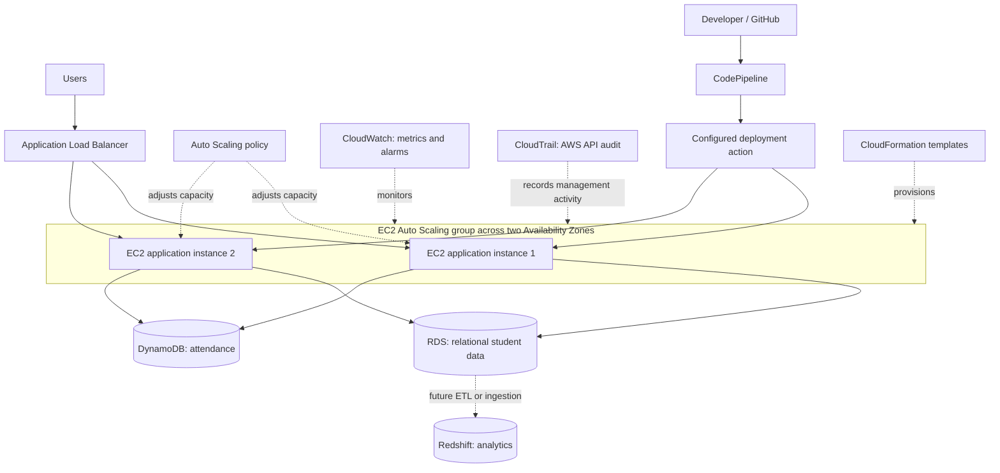

# Campus · Student Management Portal

A small student administration app for the **Build a Scalable AWS Web Application** classroom activity. Built with plain HTML, CSS, and JavaScript. No installation or build step is required for the website.

> **Current status: local prototype.** Editable records are stored in this browser's `localStorage`. The Node server also reads the attendance CSV for a separate, read-only website view. No AWS services, database, or authentication are connected. No cloud resources are created by running this project. All starter records are fictional.

## Open the app

**Browser-only demo:** open `public/index.html` in a modern browser. The connected CSV view requires the Node server below.

**Recommended for predictable browser storage:** install Node.js 20 or later, open a terminal in this project folder, and run:

```sh
node server.js
```

Open **http://127.0.0.1:4173**. Keep the terminal running while using the preview; press Ctrl+C to stop it. There are no packages to install. The development server binds only to your computer, serves website files from `public/`, and exposes a read-only attendance API.

`npm start` is an equivalent shortcut if your npm installation works. The direct Node command above also works when npm is unavailable.

On Windows PowerShell, if `npm.ps1` is blocked by the script execution policy, use `npm.cmd start` and `npm.cmd test`, or the direct Node commands. No policy change is needed.

Files opened directly may have browser-specific storage restrictions. The local server avoids that problem. Different browsers, ports, file paths and hostnames have separate records. Use the same address each time.

## What works

- Overview with live student counts, department distribution, and a six-day attendance chart.
- Student directory: add, edit, delete, search by name/ID/email, and filter by department/status.
- Duplicate ID/email checks and required-field validation. IDs remain fixed when editing.
- Daily attendance: Present, Absent, Excused, or Unmarked. Active students appear in the register; inactive students retain their history.
- Attendance changes save immediately. Bulk marking asks before replacing existing marks.
- Student CSV export uses the current directory filters. Overview exports all students.
- Attendance CSV export includes saved records for inactive students on the selected date.
- **CSV attendance** displays all rows from the server's CSV, with date filtering, counts, error messages, and a reload button.
- Local persistence, storage failure notices, and confirmation before deleting or resetting.
- Responsive layout, keyboard navigation, labeled controls, dialog focus handling, and reduced-motion support.
- Proposed AWS architecture with a downloadable diagram and all nine service selections.

The attendance rate is **Present / (Present + Absent) × 100**, rounded to the nearest whole percent. Excused and unmarked students are excluded. No recorded denominator shows a dash, not 0%. The dashboard's current-day summary includes active students; its historical chart includes all saved records for each historical date. Starter attendance covers the six dates before first use or reset, including weekends as fictional demo sessions.

There is no login, access control, shared database, production audit log, or enrollment workflow. Use fictional records only. Clearing browser storage removes editable records. Multiple devices do not share editable data. CSV import into the editable directory/register is not implemented. For a clean demonstration, use **Students → Reset demo data**.

## Connected attendance CSV

Open **http://127.0.0.1:4173/#csv**, or choose **CSV attendance** in the navigation. The server reads `campus-attendance-2026-10-06.csv` from the project folder on every request. Use **Reload CSV** after saving file changes; restarting the server is unnecessary. To read another file, set the `ATTENDANCE_CSV` environment variable to its path before starting the server.

The supplied CSV has 12 records for 6 October 2026: 1 Present and 11 Unmarked. It includes `STU-1013` (Alex Demo Updated), which is absent from the starter student directory. All CSV rows are displayed independently of browser-stored profiles. Missing email, department, and year details are not invented. The original Overview, Students, and editable Attendance pages continue to use browser storage. Editing those pages or exporting a file does not update the server's CSV.

The required columns are `Date,Student ID,Name,Student status,Attendance`. Dates must be valid `YYYY-MM-DD` dates; attendance must be Present, Absent, Excused, or Unmarked. Duplicate student/date pairs and malformed rows are rejected with an error rather than showing a partial dataset.

- `GET /api/attendance`: current CSV filename and validated rows. Returns 404 for a missing file or 422 for invalid data.
- `GET /api/health`: `{ "status": "ok" }` when the server is responding. CSV errors are reported separately by the attendance endpoint.

Static hosting of `public/` alone supports the browser demo; the CSV view needs this Node server.

## Project files

```text
student-management-portal/
├── public/                     # Deploy only this folder as the static website
│   ├── index.html
│   ├── styles.css
│   ├── app.js                  # Views, forms, local storage and interaction
│   ├── core.js                 # Validation, sample data and calculations
│   └── assets/
│       ├── favicon.svg
│       └── architecture.svg    # Proposed AWS design
├── docs/
│   ├── ASSIGNMENT.md           # All four assignment tasks and answers
│   ├── AWS-STAGES.md           # Current stage + future practical roadmap
│   └── EVIDENCE.md             # Screenshot names and report evidence rules
├── lib/attendance-csv.js         # CSV parsing and validation
├── campus-attendance-2026-10-06.csv # Read-only attendance source
├── tests/                       # Core, CSV, HTTP and app-content tests
├── .github/workflows/check.yml # GitHub checks only; does not deploy to AWS
├── .gitignore
├── .gitattributes
├── package.json
├── server.js                   # Local development server
└── README.md
```

## GitHub upload

Create an empty repository named `student-management-portal` on GitHub. Do not initialize it with another README if following the terminal route. Open a terminal **inside this project folder**, then run:

```sh
git init -b main
git add .
git commit -m "Add Campus student management portal"
git remote add origin https://github.com/YOUR-USERNAME/student-management-portal.git
git push -u origin main
```

Replace `YOUR-USERNAME` with your GitHub username. Sign in through Git's credential prompt; do not place a token or password in the URL. If Git asks for your identity, configure your chosen name and email (a GitHub no-reply email is fine), then repeat the commit. If this folder is already a Git repository, inspect `git status` and `git remote -v` first rather than reinitializing it.

Alternatively, GitHub Desktop can publish the extracted project folder. Upload the whole project, including `public/`, documentation, and hidden configuration files. Do not upload just the ZIP. The repository root should show this README and `package.json`.

Never commit AWS credentials, `.env` files, private keys, real student records, or unredacted account screenshots. The ignore file covers common secret and screenshot locations. This project has not been pushed to any repository yet.

**GitHub Actions is not AWS CodePipeline.** The included workflow runs the small test suite after a push. A later AWS stage will separately create and verify CodePipeline if required for the practical demonstration.

## Proposed AWS architecture




The diagram assumes a **future server-side API** on EC2. Static browser JavaScript must not contain database passwords or AWS keys. A backend will perform validated database operations using appropriate IAM roles and database credentials held securely on the server. Uploading these files to EC2 changes where the files are served; it does **not** move browser records into RDS or DynamoDB. Creating empty databases also does not establish integration.

For a production design, add HTTPS, authentication/authorization, a VPC with appropriate public/private subnets, restricted security groups, backups, and a stateless API. That implementation is outside this simple prototype.

## Assignment and practical work

The source `AWS Actuvity.pdf` states that this is a handwritten activity and AWS accounts are not required. Its required outputs are the service table, diagram, five conceptual answers, and traffic case study. This app, GitHub upload, and AWS screenshots are optional practical extensions.

- [Complete assignment answers](docs/ASSIGNMENT.md)
- [AWS Stage 1 and practical roadmap](docs/AWS-STAGES.md)
- [Screenshot checklist for the final report](docs/EVIDENCE.md)

Work through the AWS stages **one at a time**. Start with account and cost checks. Do not create the whole diagram at once.

## Verify the project

```sh
node --test
```

The dependency-free tests check attendance calculations, date boundaries, duplicate validation, deletion of related records, saved-data validation, safe CSV output, CSV parsing, HTTP routes, file refreshes, and errors. App-content tests run the actual frontend script with a minimal DOM adapter and the real HTTP API to verify all CSV rows reach the generated table without changing saved browser records. They do not test browser layout. Browser checks should also cover: CSV navigation and reload, add/edit a fictional student, search and filter, mark attendance, reload to verify persistence, export CSV, cancel/confirm dialogs, and a narrow viewport. The app downloads no external fonts, scripts, or images.

`npm test` runs the same checks when npm is available.

## Deployment state

| Component | State in this delivery |
|---|---|
| Local prototype | Implemented |
| GitHub repository | Ready for your upload; not pushed |
| EC2 / ALB / Auto Scaling | Proposed; not configured |
| RDS / DynamoDB | Proposed; not connected |
| CloudWatch / CloudTrail evidence | Not collected |
| CodePipeline | Proposed; not configured |
| CloudFormation | Selected for IaC; no template deployed |
| Redshift | Selected for analytics; not provisioned |

Update this table only after verifying the relevant stage. A local screenshot proves the prototype UI, not AWS infrastructure. The final PDF will be prepared later from actual screenshots and these assignment answers.
