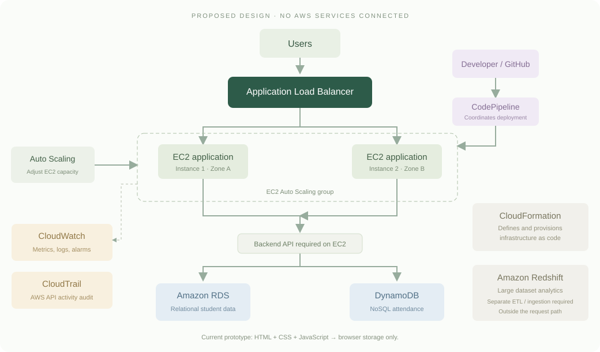

# AWS classroom activity — completed design answers

Based on the two-page **AWS Actuvity.pdf**, titled **Build a Scalable AWS Web Application**. The worksheet specifies a 45–60 minute handwritten activity for groups of 2–4. Its instructor note says AWS accounts are unnecessary and the focus is understanding services and their interactions.

**Implementation disclosure:** Campus is currently a static browser prototype with fictional data. The architecture below is proposed. No claim of AWS deployment, database integration, load testing, or successful automatic scaling is made.

## Task 1 — Select the AWS service

| Requirement | Selected AWS service | Reason |
|---|---|---|
| Store relational student data | Amazon RDS | SQL tables and relationships suit students, courses, and enrollments. |
| Store NoSQL attendance data | Amazon DynamoDB | Key-value/document storage fits student/date attendance records. |
| Analyze large datasets | Amazon Redshift | A managed data warehouse for university analytics using SQL. |
| Distribute traffic among servers | Application Load Balancer (Elastic Load Balancing) | Routes HTTP/HTTPS traffic to healthy application targets. |
| Automatically add/remove EC2 instances | Amazon EC2 Auto Scaling | Adjusts an Auto Scaling group's capacity under configured policies. |
| Monitor CPU and application performance | Amazon CloudWatch | Collects metrics; supports dashboards, logs, and alarms. Application logs/metrics must be configured. |
| Record AWS API/user activities | AWS CloudTrail | Records supported AWS management activity and who performed it. It is not automatically an audit log of student actions inside the app. |
| Automate application deployment | AWS CodePipeline | Coordinates source and delivery stages with configured deployment tools/actions. |
| Define infrastructure using code | AWS CloudFormation | Describes resources in repeatable templates and manages them as stacks. |

## Task 2 — Draw the AWS architecture

Draw **Users → Application Load Balancer → EC2 instances → RDS / DynamoDB**. Place EC2 instances inside an Auto Scaling group, preferably across two Availability Zones. Add Auto Scaling for EC2 capacity, CloudWatch for monitoring, CloudTrail for auditing, and **Developer → CodePipeline → Application** for releases.

The EC2 application would include a backend API to talk to the databases. CloudFormation can define the resources. Redshift is a separate analytics destination after an ingestion/ETL process; it is not needed on every student request. These extra notes explain the service-selection table without changing the required main request flow.

## Task 3 — Conceptual answers

### 1. Why is an Application Load Balancer required in this application?

It gives users a single application endpoint and distributes HTTP/HTTPS requests across healthy EC2 targets. This spreads work across servers and allows traffic to continue reaching healthy targets when another target fails. Health checks and multiple healthy instances must be configured; the ALB does not create capacity itself.

### 2. What happens when the number of users suddenly increases?

Request volume can exceed the capacity of the existing servers or databases. CPU usage and response time may rise, requests may queue or time out, and some students may be unable to register. The effect depends on what users do, not just the number of users.

### 3. How does EC2 Auto Scaling solve this problem?

An Auto Scaling group uses a launch template and a scaling policy to add instances when demand increases and remove excess instances when demand falls, within configured minimum and maximum limits. A target tracking policy can use average CPU or ALB requests per target. Instances must launch, become healthy, and join the target group before taking traffic. This takes time, so scheduled capacity can help with a known examination rush. EC2 scaling alone does not remove database bottlenecks.

### 4. Differentiate between CloudWatch and CloudTrail.

| Amazon CloudWatch | AWS CloudTrail |
|---|---|
| Observes system/application health and performance. | Records supported AWS account/API activity for auditing. |
| Metrics, logs, dashboards, and alarms. | Event history and configured trails/event stores. |
| Example: CPU remains above a target; response time rises. | Example: an identity launches an EC2 instance or changes a security group. |
| Answers “How is the system behaving?” | Answers “Who did what in AWS, and when?” |

CloudTrail Event history exposes the last 90 days of regional management events without creating a trail. Data events, such as many item/object access operations, are separate and may require configuration and incur charges. Student attendance changes in this browser prototype are not AWS API events.

### 5. Why would an organization use CodePipeline?

CodePipeline coordinates a repeatable delivery process after a source change: obtain the code, run configured checks/builds, and invoke deployment actions. This reduces manual release steps and makes execution outcomes visible. A pipeline only performs the stages actually configured; a successful source stage alone does not prove the app was deployed.

## Task 4 — 1,000 to 10,000 users

**a) What problem can occur?** Existing capacity may be overwhelmed, causing high CPU, slow responses, timeouts, or failed examination registrations. Database connection or query limits can also become a bottleneck.

**b) Which AWS service distributes the traffic?** Application Load Balancer.

**c) Which service increases the number of EC2 instances?** Amazon EC2 Auto Scaling.

**d) Which service monitors CPU utilization?** Amazon CloudWatch.

**e) Which service records AWS API activities?** AWS CloudTrail.

Ten times as many users does not automatically mean exactly ten times as many EC2 instances. Capacity should be based on measured request rates, latency, resource usage, and workload. No 10,000-user test has been performed for this prototype.

## Official references

- [Amazon RDS](https://docs.aws.amazon.com/AmazonRDS/latest/UserGuide/Welcome.html) and [DynamoDB](https://docs.aws.amazon.com/amazondynamodb/latest/developerguide/Introduction.html).
- [Amazon Redshift](https://docs.aws.amazon.com/redshift/latest/mgmt/).
- [Application Load Balancers](https://docs.aws.amazon.com/elasticloadbalancing/latest/application/introduction.html).
- [Auto Scaling target tracking](https://docs.aws.amazon.com/autoscaling/ec2/userguide/as-scaling-target-tracking.html).
- [CloudWatch](https://docs.aws.amazon.com/AmazonCloudWatch/latest/monitoring/WhatIsCloudWatch.html) and [CloudTrail Event history](https://docs.aws.amazon.com/awscloudtrail/latest/userguide/view-cloudtrail-events.html).
- [CodePipeline EC2 deployment action](https://docs.aws.amazon.com/codepipeline/latest/userguide/action-reference-EC2Deploy.html).
- [RDS resources with CloudFormation](https://docs.aws.amazon.com/AmazonRDS/latest/UserGuide/creating-resources-with-cloudformation.html).

The final report should include these answers, the diagram, the actual repository link, and clearly captioned screenshots for only the practical work completed.
